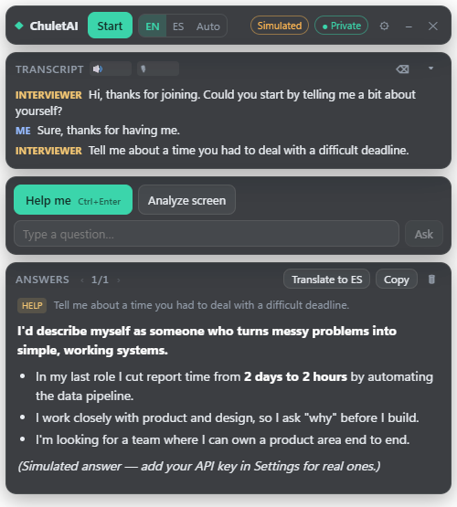
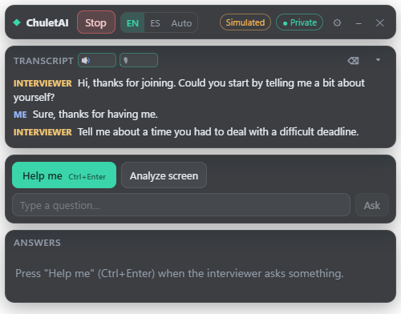
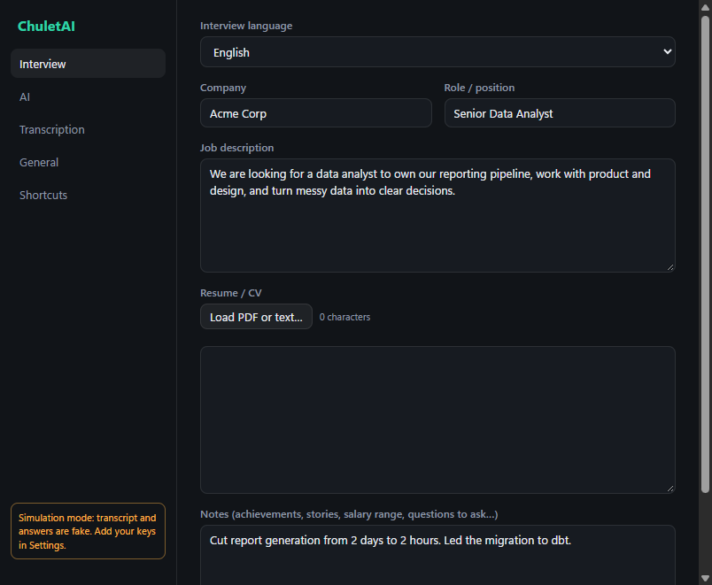
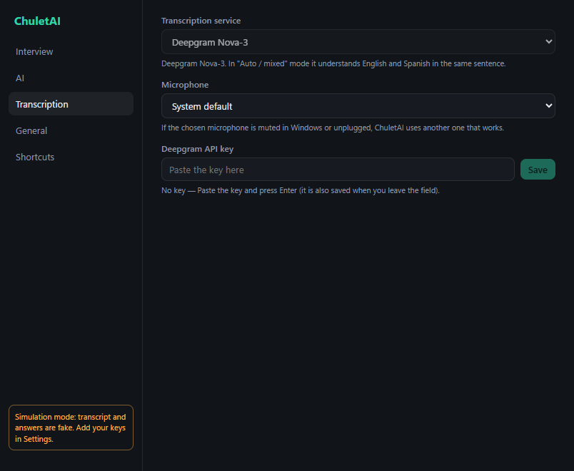

<div align="center">


# ChuletAI

**A live AI copilot for interviews and calls on Windows.**
It transcribes the call in real time and, with one shortcut, suggests what to say, in a small floating window.

[Download for Windows](https://github.com/alejoalvareztobon-stack/ChuletAI/releases/latest) · [Features](#features) · [Install](#install) · [Usage](#usage) · [Build from source](#build-from-source)


</div>

<p align="center">
  
</p>

ChuletAI listens to both sides of a call. It picks up the other person from your system audio and you from your microphone, and shows a live transcript. Press **Ctrl+Enter** and it writes a short first-person answer to the last question, grounded in your resume and the job description. You get one line you can say as-is, plus a few supporting points.

> "Chuleta" is Spanish slang for a cheat sheet.

## Features

- **Live transcription, speaker-separated.** Deepgram Nova-3 streaming, with *Interviewer* (system audio) and *Me* (microphone) on separate channels. Works in English, Spanish, or both mixed in the same sentence.
- **Instant answers.** Streaming answers from Claude Haiku 5.5, or Google Gemini Flash. They are short, in the first person, and in the language of the interview.
- **Three actions:**
  - **Help me** (`Ctrl+Enter`) answers the interviewer's last question.
  - **Analyze screen** (`Ctrl+Shift+Enter`) takes a screenshot and explains it, for example a coding exercise.
  - **Ask** sends a question you type.
- **Interview context.** Load your resume (PDF or text), the job description, the company, the role and your own notes. All of it goes into the prompt.
- **Floating overlay.** Transparent and always on top. Clicks pass through to the app below, and it only becomes clickable when you hover a panel.
- **Private mode.** The window is excluded from screen sharing, screenshots and recordings (see [Private mode](#private-mode)).
- **Reliable on bad connections.** Audio goes out as Opus (about 8× smaller than raw PCM), with automatic reconnection, a DNS fallback and on-screen warnings when the upload falls behind.
- **Smart microphone choice.** It uses the system default, or a microphone you pick. If that one is muted in Windows or unplugged, it falls back to one that works.
- **Translate & copy.** Switch any answer between English and Spanish, or copy it in one click.
- **Bilingual UI** in English and Spanish.
- **Your keys, no server.** ChuletAI talks directly to Deepgram and Anthropic or Google with your own API keys. The keys are encrypted with Windows DPAPI.

<table>
  <tr>
    <td></td>
    <td></td>
  </tr>
  <tr>
    <td align="center"><sub>Live transcript, interviewer vs. me</sub></td>
    <td align="center"><sub>Interview context: resume, role, job description, notes</sub></td>
  </tr>
</table>

## Requirements

| | |
|---|---|
| **OS** | Windows 10 version 2004 (May 2020) or later, or Windows 11, 64-bit |
| **Deepgram API key** | For live transcription. [console.deepgram.com](https://console.deepgram.com) → API Keys. New accounts come with free credit. |
| **Anthropic API key** | For answers with Claude. [console.anthropic.com](https://console.anthropic.com) → API Keys |
| **Google Gemini API key** *(optional)* | Alternative AI provider. [aistudio.google.com/apikey](https://aistudio.google.com/apikey) |

Without keys the app runs in **simulation mode**: a sample transcript and sample answers, so you can try the window and shortcuts first.

## Install

1. Go to the [latest release](https://github.com/alejoalvareztobon-stack/ChuletAI/releases/latest) and download **`ChuletAI-Setup-<version>.exe`**.
2. Run it. The installer isn't code-signed, so Windows SmartScreen may say *"Windows protected your PC"*. Click **More info → Run anyway**.
3. Pick the install folder. The installer creates a desktop shortcut.
4. ChuletAI starts in the system tray (green ◆ near the clock) and shows the floating window in the top-right corner.

To **uninstall**: *Settings → Apps → ChuletAI → Uninstall*. To also remove your settings and keys, delete `%APPDATA%\ChuletAI`.

## Set up your API keys

Open **Settings**: the ⚙ gear on the floating window, or right-click the tray icon → *Settings*.

| Service | Settings tab |
|---|---|
| Anthropic (Claude) | **AI** |
| Google Gemini (optional) | **AI** → Provider: Gemini |
| Deepgram | **Transcription** |

Paste each key and press **Enter**. Keys also save when you leave the field. Settings shows "*Key saved (encrypted) · ends in …1234*" so you can tell which key is stored without exposing it.

Keys are encrypted with Electron's `safeStorage` (Windows DPAPI) in `%APPDATA%\ChuletAI\keys.json`. They are never stored in plain text and never reach the UI.

<p align="center"></p>

## Usage

1. **Before the call**, open *Settings → Interview*. Choose the interview language, enter the company and role, paste the job description, load your resume and add notes. Good notes include achievements with numbers, stories for behavioral questions, your salary range and questions you want to ask.
2. **When the call starts**, press **Start** on the floating window. The 🔊 (system) and 🎙 (microphone) meters show audio levels.
3. **When the interviewer asks something**, press **Ctrl+Enter**. Within seconds you get a bold line you can say as-is, followed by 2–4 supporting points.
4. **For an on-screen exercise**, press **Ctrl+Shift+Enter** (*Analyze screen*).
5. **To ask your own question**, press **Ctrl+Shift+Space** or click the text box, type, and press Enter.
6. Use **Translate to EN/ES** and **Copy** on any answer.

**Interview language** (EN / ES / Auto in the top bar):
- **EN** or **ES**: transcription and answers in that language.
- **Auto**: Deepgram understands English and Spanish mixed together, and each answer comes out in the language of the interviewer's last question.

**Move** the window by dragging "◆ ChuletAI" or with Ctrl+arrows. **Hide** it with Ctrl+H or the "–" button. **Quit** with the ✕ button, or right-click the tray icon → *Quit*.

### Shortcuts

| Shortcut | Action |
|---|---|
| `Ctrl+Enter` | Help me: answer the last question |
| `Ctrl+Shift+Enter` | Analyze screen |
| `Ctrl+H` | Hide / show the window |
| `Ctrl+↑ ↓ ← →` | Move the window |
| `Ctrl+Shift+← / →` | Previous / next answer |
| `Ctrl+Backspace` | Clear the transcript |
| `Ctrl+Shift+Backspace` | Clear the answers |
| `Ctrl+Shift+Space` | Make the window interactive and type a question |

Shortcuts are **global**: while ChuletAI runs, those key combinations stop reaching other apps (for example, Ctrl+Backspace no longer deletes words in Word). If that gets in the way, switch to **Ctrl+Alt** in *Settings → General → Shortcut modifier*, so every shortcut becomes `Ctrl+Alt+…`.

### Private mode

Private mode is **on by default** (green "● Private" badge). It calls `SetWindowDisplayAffinity(WDA_EXCLUDEFROMCAPTURE)`, so Windows leaves the window out of screen sharing (Zoom, Meet, Teams, browser tab or full-screen sharing), screenshots and recordings. Click the badge to turn it off.

What it does **not** do:
- It doesn't hide the window from someone looking at your monitor, or from a camera pointed at it.
- It doesn't hide the process: `ChuletAI.exe` is visible in Task Manager, and proctoring tools that inspect running processes can see it.
- On Windows versions older than 2004, a black box appears instead of the window.

## Costs

ChuletAI is free. You only pay the providers, with your own keys. These are approximate list prices as of November 2026, so check each provider's pricing page.

| Item | How it's billed | Cost |
|---|---|---|
| Transcription (Deepgram Nova-3, streaming) | About $0.006–0.009 per minute **per channel**; ChuletAI uses 2 channels | **≈ $0.70–1.10 per hour** of call |
| Answers (Claude Haiku 5.5) | $0.10 / M input tokens, $0.50 / M output tokens. Each answer is about 5–10k tokens in and 200 out | **≈ $0.001 per answer** |
| Analyze screen | Same as an answer, plus the image (about 1,500 tokens) | ≈ $0.002 per screenshot |

A one-hour interview with 30 requests costs **about $1**, almost all of it transcription.

## Customizing the prompts

The prompts are Markdown files in [`src/shared/prompts/`](src/shared/prompts/):

| File | Used for |
|---|---|
| `system.md` | Style rules and interview context |
| `help.md`, `help-no-question.md` | Help me |
| `screen.md` | Analyze screen |
| `direct.md` | Your own question |
| `translate.md` | Translate |
| `lang-en.md`, `lang-es.md`, `lang-auto.md` | Language rule |
| `length-short.md`, `length-medium.md` | Answer length |

To change them **without rebuilding**, create `%APPDATA%\ChuletAI\prompts\` and put a file with the same name in it, for example `system.md`. ChuletAI uses your file instead of the built-in one. `{{...}}` placeholders are filled in automatically.

## Privacy

- Audio goes to **Deepgram**. Text, and screenshots if you use *Analyze screen*, go to **Anthropic** or **Google**. Both use your own keys. ChuletAI has no server of its own and no telemetry.
- Settings, your resume and notes are stored unencrypted in `%APPDATA%\ChuletAI\settings.json`. API keys are encrypted in `keys.json`.
- The diagnostic log (`%APPDATA%\ChuletAI\logs\chuletai.log`) records connection events, audio levels and message counts. It never records transcript text or keys.

## Troubleshooting

| Symptom | What to do |
|---|---|
| "Listening…" but no text appears | Check the 🎙 / 🔊 meters and the warning under *Transcript*. If your default microphone is muted in Windows, ChuletAI switches to another one automatically; you can also choose one in *Settings → Transcription → Microphone*. Details are in `%APPDATA%\ChuletAI\logs\chuletai.log`. |
| The interviewer isn't transcribed | System audio is captured from Windows' default output device. Make sure the call plays through that device. |
| A meter turns red | Hover it to see the error. For the microphone: *Windows Settings → Privacy & security → Microphone → Let desktop apps access your microphone*. |
| Transcript stops or lags | Look at the orange warning (reconnecting, no audio, or slow upload). Pause other uploads (OneDrive, backups) or use a cable. |
| `Anthropic: invalid API key (401)` / `Deepgram: invalid API key (401)` | Paste the key again in Settings. |
| `Deepgram: no credit left on the account (402)` | Add credit to your Deepgram account. |
| Shortcuts don't respond | Another app may already use the same combinations. Switch to Ctrl+Alt in *Settings → General*. |
| SmartScreen blocks the installer | Click *More info → Run anyway*. The installer isn't code-signed. |

## Build from source

**Prerequisites:** Windows 10/11 x64, [Node.js](https://nodejs.org) 20.19+ or 22.12+, and [Git](https://git-scm.com).

```powershell
git clone https://github.com/alejoalvareztobon-stack/ChuletAI.git
cd ChuletAI
npm ci
npm run dev
```

If `npm run dev` says Electron isn't installed (its install script sometimes skips the binary download), run `node node_modules/electron/install.js` once.

| Command | What it does |
|---|---|
| `npm run dev` | Run the app with hot reload |
| `npm test` | Unit tests (Vitest) |
| `npm run typecheck` | TypeScript checks |
| `npm run selftest` | End-to-end self-test of the real app in simulation mode (see below) |
| `npm run selftest:live` | Live test with your real keys (Deepgram + Claude) |
| `npm run screenshots` | Regenerate the README screenshots in `docs/images/` |
| `npm run build` | Build the installer in `release\ChuletAI-Setup-<version>.exe` |

**Self-test.** `npm run selftest` launches the built app with a temporary profile in simulation mode. It checks the window styles (always on top, hidden from Alt+Tab, click-through), private mode via real screen captures, key encryption, UI language switching, the global shortcuts with real key presses, and the full flow: transcript → Help me → answer, translate, and analyze screen. It moves the mouse and presses keys for about 40 seconds, so don't touch anything while it runs. Close any installed ChuletAI first, or the shortcut checks will fail.

**Tech stack:** Electron 45, React 19, TypeScript, electron-vite, electron-builder (NSIS), Deepgram streaming over WebSocket (`ws`), Anthropic SDK, Google GenAI SDK, `unpdf` for PDF resumes.

**Project layout:**

```
src/main/        main process: windows, shortcuts, loopback audio, AI, Deepgram, settings and keys
src/preload/     secure bridge (window.chuletai)
src/renderer/    React UI (overlay and settings) and audio capture
src/shared/      Electron-free logic: prompts, transcript, i18n, shortcuts, types
tests/           unit tests
docs/images/     README screenshots
```

Design decisions and their reasons are recorded in [DECISIONS.md](DECISIONS.md).

## Responsible use

Many companies and exam platforms don't allow AI assistance during interviews or assessments. Check the rules before you use ChuletAI in one, and respect them. Getting caught usually ends the process. It also works well for practicing with mock interviews.

## License

[MIT](LICENSE)
